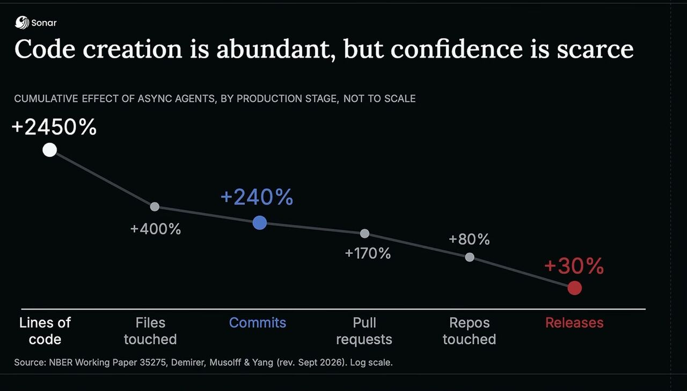

I have [written](/_posts/2026-07-12-ai-flow-throughput.md) [many](/_posts/2026-09-24-true-north.md) [times](https://lnkd.in/p/dJiN4WAg) about how I feel about the current obsession of output over outcome. Here's an example of numbers that I see presented with a bit of a worried look.

+2450% lines of code, 400% increase in files touched, 240% more commits and 170% increase in number of PRs, but only 30% more releases. So bigger releases a bit more frequently is how I read that. To be honest 30% increase in number of releases is mind blowing, but in combination with the other metrics scares me.

I've spent a hefty portion of my career preaching the opposite. Smaller things more frequently rather than bigger things seldom. Here we see bigger things more frequently.

And there's another thing that is not even tracked in the picture above - what happened? What was the outcome of the increased output? For example, did the increase in the number of release have to do with failure demand since our releases now also were bigger?

The agile, and lean, answer to this problem is clear; smaller batches. Let's play with the idea.

<!-- excerpt-end -->

This is my own observation after following the product development AI adoption closely from the last 1.5 years or so. I don't have the data to back it up, but - I haven't heard a lot people radically changing their processes and workflows in the wake of AI.

In fact, even when we create software factories we mimic the current (or olden) ways of working by creating project manager developer and tester agents. That might be good, or not - I don't know. No one does right now.

I am, however, convinced that smaller batches would be better. Let's play with the idea and say that we shorten the sprint to one day. Yes, I'm a kanban guy so I am obligated to write that there are ~~other ways~~ better ways of doing this. Here I'm using one-day-sprint to prove a point.

A full one-day sprint should include everything that a sprint does:

- planning / refinement
- developing
- testing including acceptance testing
- delivering a product increment to production (hopefully)
- retrospective

With the improved productivity a one-day-sprint like this would still make a big dent in the product backlog ([what. am. I. doing](https://www.marcusoft.net/2018/01/backlog-drinking-song-a-story-about-waste.html) - I really dislike that word).

I can totally see this planned out like this:

| Time | Activity |
| :--- | :--- |
| 0900-1100 | planning sessions for product owner and product engineers (cross functional roles). Deciding on goals for the sprint that we can track once the feature reaches users |
| 1100-1145 | collaborative prompting of our (gulp) software factory agent team |
| 1200-1300 | lunch - our software factory creates the application, using our prompts, tools, checks and CI/CD chains |
| 1300-1500 | verifications, tweak of prompts and regeneration, where needed. Iterative and incrementally |
| 1500-1530 | Automated deploy via CI/CD, which is mostly waiting |
| 1500-1600 | Improvement times! Retrospective, learnings and updating of software factory, backlog grooming |

## The good parts

One obvious good thing here is focus of the team. With a single day's worth of work, it cannot be a lot of different things going on. 2, maybe 3 things could be worked on for a normal team. It's a much higher chance of everyone in the team to be in the know about what is going on.

The scope of each of these things will have to be sliced down to fit the timebox (the foundational principle of sprints). This means that it's easier to reason about, easier and faster to build and fewer places for uncertainty to hide. There's still uncertainty but a tight timebox like this will make it harder for them to hide.

We are also integrating and testing the entire systems with all the new features very frequently. This makes merges simpler, pull requests smaller and easier to handle and the overall understanding of the changes we make easier and better known.

Since the advent of agents, we can still make quite a lot of progress in a day, which means that the thing that we end up building has a good chance of making a change in the product we create.

The visibility of what we create can be very clear and frequently communicated with those that want to know around us, with daily progress reports on what we are working on and how far we have come.

## The challenges

Well... that's a lot of ceremonies, now isn't it? Yes. Yes it is. That's how we play Scrum. When I wrote down the agenda, it looked like we'd be in meetings all day: planning, prompting, verifying what the agents did.

I think that's the most interesting thing the experiment shows. Four things break, and they are all old friends.

### It's stressful, and it's all meetings

When the agents do the building, typing code stops being the slow part. Deciding what to build and checking that we got it are what's left. Two of the six rows in my table are verification. The bottleneck moved to the humans, and a timebox squeezes that bottleneck into fixed slots on the clock. Hello, stress.

Now imagine we drop the sprint and follow a work item through the stages instead. We still slice it to fit in a day or two, so the batches stay small. But we plan when there's room (see [from push to pull](https://www.marcusoft.net/2017/08/from-push-to-pull-the-essence-of-lean.html)) and hold the retrospective at the end of each week or two.

Same small batches, no stopwatch.

### How do we get hold of people that fast?

A one-day cycle needs the product owner, and someone who can say "yes, that's what we meant", in the room at the right moment. If your product owner is in six other meetings, your one-day sprint is a one-week sprint with an optimistic title.

This is where [low Work in Process](https://www.marcusoft.net/2017/10/two-stories-i-often-tell-on-wip-as-a-process-improvement-tool.html#more-wip-here-please) pays off. When fewer things are going on at once, people have room to show up for the ones that are. We would have to change how we work to make that happen, and that's the point.

### Move the authority to the information

There's another, much more powerful, way to solve this problem; by [moving the authority to the information](https://www.marcusoft.net/2014/06/move-information-to-authority-and-not.html).

In other words; give higher level intent to the product team for what they should accomplish and let them own the details of what to build when.

It's the powerful message of David L. Marquet's book [Turn the ship around](https://davidmarquet.com/books/turn-the-ship-around-book/) and is really unlocking the power of the speed benefit that agentic work can give you.

There's only one problem: how would you know that they are doing the right thing?

Well that's easy - that's on you. This is what leadership is all about and your job, now freed up from giving detailed instructions on HOW, becomes to instill the knowledge, culture and understanding that they will need to make the best decisions. And, to paraphrase Mr Marquet: if they make another decision it is a better decision, because they have more information than you.

Trust is both scary and powerful. And fun!

### Slicing user stories, like that, is hard

Yes. This used to be true. I know many teams that have given up on trying even.

But I have two reflections: First a one-day box forces you to practice it, and slicing is a skill that gets better with reps, like most things that hurt at first.

Secondly, I do know that agents are amazing in helping out with the slicing both in planning and in developing - so I'm guessing it will not be that hard in practice.

## Summary

Nobody should run one-day sprints. I think - you tell me.

I'm a kanban guy, remember? But trying to describe one is a cheap way to see what stands between us and smaller batches. Planning, verifying and deciding have become the constraint. People need to be available when the work needs them. And slicing is still the skill we need to get better at.

None of these are new problems. They just show up faster now, because building is no longer the slow part.

And if the waiting is about decisions, empower the team by giving them intent and let them own the details (Marquet has a whole book on that)

So here's a challenge for Monday morning. Pick one feature and slice it to fit a day. Ship it. Then count what happened for the users, not how many lines of code it took. I'd love to hear how it goes.
