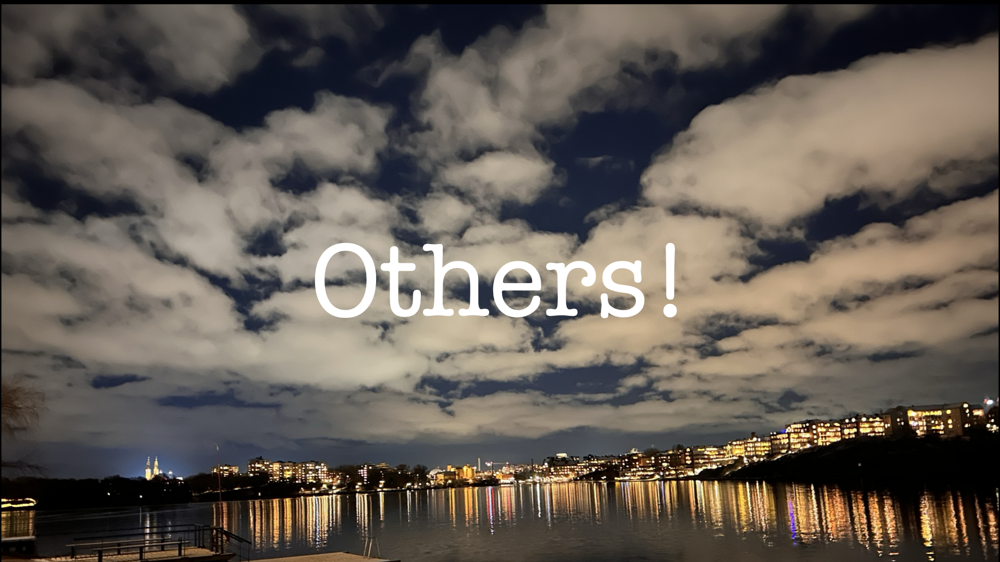

A few years back I wrote about some of the sayings that I like so much that I have them as daily reminders, in the form of screen savers.

Yesterday I was reminded by another and I thought I'd write a blog post on it - it's just one word, and turns out to be great career, leadership and business advice - `Others!`

Here's the list of the others (pun very much intended):

- [Kindness is better](https://www.marcusoft.net/2023/03/my-screensavers-kindness-is-better.html)
- [Complex == Bad. Simple == Good](https://www.marcusoft.net/2023/03/my-screensavers-simple-good-complex-bad.html)
- [What would Jesus do?](https://www.marcusoft.net/2023/03/my-screensavers-what-would-jesus-do.html)
- [(DO(SOMETHING(SMALL(USEFUL(NOW())))))](https://www.marcusoft.net/2023/03/screensavers-do-something-small-useful-now.html)
- [Turn up the good](https://www.marcusoft.net/2023/03/my-screensavers-turn-up-the-good.html)

<!-- excerpt-end -->

## The origins - William Booth

The single word `Others!` (yes, with the exclamation mark) is actually a telegraf message sent by the founder of the Salvation Army, on Christmas Eve, 1910. At this point the founder was old and tired, so he couldn't attend the annual gathering of his now very active church.

But he still wanted to encourage as many as possible of his leaders and members in the most effectful way. He wanted to sum up the credo of the Salvation Army and did so with the single word:

> Others!

There are stories about that he didn't have a lot of money to spare on this and used the little he had to reach as many as possible by sending this one word to more people.

There's so much Salvation Army in this story; first the focus on helping, supporting and bringing the people NOT in church to Jesus. Which incidentally was the ideal of Jesus himself (`“It is not the healthy who need a doctor, but the sick.` Matt 9:12).

Also, making the most good with little means, and a lot of passion, is at the heart of the Salvation Army ways of working.

Finally it shows clearly what the goal is, in tense and clear communication. This is something that the Salvation Army, at it's best, does really well. The exclamation mark shows clearly that this is an instruction not a finger pointing exercise. Go get the `Others!` Direct your focus there, not internally!

## Leadership

Thinking about `Others!` rather than ourselves is the foundation of many good leaders I've seen. The statement "Leaders eat last" from the military world, shows a similar thought.

Leadership is about caring for people and ensuring that the context, clarity and direction is there for them to be the best version of themselves. Then we will win! Not when I (the leader) have the most fun day, high salary or power.

Yes, to a point. Leaders that 100% focus on others will burn out. In fact, I've seen it more than once in the Salvation Army itself. Maybe because the focus on `Others!` was too great. A leader need to care about themselves too, or the `Others!` will get 0. Balancing these two focuses is hard and the people that I've seen doing that great are also naturally great leaders.

## Business

Starting a business plan for a new service with the goal to make money usually doesn't reach that far. With a product mindset and especially in the Lean world, we should instead start with `Others!` (usually referred to as the customer or user) in mind.

One of the reasons I love working with Lean is that it very naturally have the customer in focus. In the one sentence summary of the Toyota Product System Taiichi Ohno wrote:

> All we are doing is looking at the time line, from the moment the **customer** gives us an order to the point when we collect the cash.

The foundational important point is that they start from the customers perspective. Not by trying to earn as much money as possible.

This is good advice for any sustainable product - solve a real problem and see if you can make money doing so. Everything else will soon be very easy to see and your customer will quickly feel like they are used.

## Career

One of the best speaker tips I got when I held a sermon and I asked my friend Kalle Ljungholm, that is a pastor, for help. He's advice was short and brutal:

> When you do a sermon - you are not the most important thing

After that point I just realized that I'm never the most important thing, when presenting. `Others!` are. Not wasting peoples time, is the trademark of Scott Hanselmann and his presentations have always both entertained and educated me. This is what I strive for too.

## The picture

All in in all - `Others!` is a great mantra to keep in the back of your head. Here's my high resolution image that you can download.

